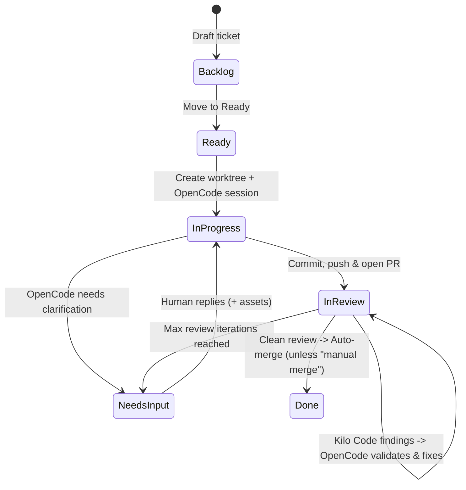

# GitHub Project Ticket Consumer

A zero-dependency TypeScript/Node.js daemon that polls a **GitHub Project v2** board, orchestrates **OpenCode** coding sessions in isolated `git worktree`s, handles human-in-the-loop Q&A (including image/file attachments), validates and fixes **Kilo Code** PR review findings, and auto-merges clean PRs.

## Workflow



1. **Backlog**: Ignored while you draft and refine tickets.
2. **Ready**: Picks up the ticket, creates an isolated `git worktree` (`ticket/<num>-<slug>`), starts an OpenCode session, and moves the card to **In progress**.
3. **Needs input**: If OpenCode needs clarification, it posts a comment on the issue and moves the card to **Needs input**. When an allowed human user replies (with text and/or uploaded images or files), the service downloads the attachments, forwards them to the *same* OpenCode session, and moves the card back to **In progress**.
4. **In review**: Ensures changes are committed and pushed, opens a PR (`Closes #<num>`), and waits for the **`Kilo Code Review`** CheckRun and `kilo-code-bot[bot]` summary/inline comments:
   - **Findings**: Sends the summary and all inline diff comments to OpenCode with instructions to validate each finding first, fix valid issues, and push.
   - **Clean**: Auto-merges the PR, cleans up the worktree, and moves the card to **Done**—unless the ticket has the `manual merge` label:
     - `keep_in_review` (default): Adds the `ready to merge` label, comments on the issue, and waits in **In review** until you merge the PR manually, then moves it to **Done**.
     - `move_to_done`: Moves the ticket to **Done** immediately while leaving the PR open for you to merge.

## Features

- **Zero external npm dependencies**: Runs directly on Node.js `>= 22.18.0` using native TypeScript execution, `node:sqlite`, `fetch`, and `node:test`.
- **OpenCode v1 & v2 compatible**: Automatically detects OpenCode v1 (`/session`, `/session/{id}/message`, `/event`) and v2 (`/api/session`, `/api/session/{id}/prompt`, `/api/event`) servers. Detection probes each dialect's message endpoint with a dialect-valid body and classifies by the error envelope, so a 1.x server that serves **both** surfaces is still detected correctly.
- **Git worktree isolation**: Each active ticket runs in its own worktree under `DATA_DIR/worktrees/issue-<number>`, allowing multiple tickets to be in `Needs input` or `In review` simultaneously without branch conflicts.
- **SQLite state persistence**: Resumes cleanly across restarts (`DATA_DIR/state.db`).

## Prerequisites

1. **Node.js `>= 22.18.0`** (tested on Node 26) and **`git`**.
2. **OpenCode server** running on the same machine as this consumer (so both share access to the `git worktree` directories).
3. **GitHub Project v2** with a `Status` field containing these exact 6 lanes:
   `Backlog`, `Ready`, `In progress`, `Needs input`, `In review`, `Done`.
4. **GitHub Token** (PAT with `repo`, `project`, and `read:org` scopes if using an org project).
5. **The `gh` CLI**, authenticated for the target repository — only needed for
   `COMMENT_DELIVERY=agent` (the default), where the agent fetches the review
   comments and the human replies itself instead of the daemon quoting them
   into the prompt. The daemon checks it at startup and falls back to
   `COMMENT_DELIVERY=inline` when it is missing or unauthenticated, so this is
   a soft requirement rather than a hard one.

   The `gh` the **agent** uses is the one on the agent server's `PATH`, not the
   daemon's: they must resolve to the same binary and the same
   `~/.config/gh/hosts.yml`.

## Quick Start

1. **Clone this repository** and **clone your target repository**:
   ```bash
   git clone https://github.com/your-org/github-project-ticket-consumer.git
   cd github-project-ticket-consumer

   git clone git@github.com:your-org/your-repo.git /var/lib/ticket-consumer/repo
   ```

2. **Configure `.env`**:
   ```bash
   cp .env.example .env
   ```
   Set at minimum:
   - `GITHUB_TOKEN`, `GITHUB_OWNER`, `GITHUB_REPO`, `GITHUB_PROJECT_NUMBER`, `GITHUB_ALLOWED_AUTHORS`
   - `OPENCODE_SERVER_URL`, `OPENCODE_PROVIDER_ID`, `OPENCODE_MODEL_ID`
   - `REPO_LOCAL_PATH` (path to your cloned target repository)

3. **Run**:
   ```bash
   node src/index.ts
   ```

## Configuration Reference

| Variable | Default | Description |
| --- | --- | --- |
| `GITHUB_TOKEN` | *(required)* | GitHub token with `repo` and `project` scopes |
| `GITHUB_OWNER` | *(required)* | Repository & Project owner |
| `GITHUB_REPO` | *(required)* | Target repository name |
| `GITHUB_PROJECT_NUMBER` | *(required)* | GitHub Project v2 number (`gh project list --owner <owner>`) |
| `GITHUB_ALLOWED_AUTHORS` | `GITHUB_OWNER,MennaCC` | Comma-separated usernames allowed to answer `Needs input` questions |
| `REVIEW_BOT_LOGINS` | `kilo-code-bot[bot]` | Comma-separated code-review bot logins |
| `REVIEW_CHECK_NAME` | `Kilo Code Review` | GitHub CheckRun name to wait for before reading review results |
| `REQUIRE_ALL_CHECKS` | `true` | Wait for all other CI CheckRuns to pass before auto-merging |
| `OPENCODE_SERVER_URL` | `http://127.0.0.1:4096` | OpenCode server base URL |
| `OPENCODE_PROVIDER_ID` | *(required)* | Provider ID (e.g., `anthropic`, `kilo`, `openai`) |
| `OPENCODE_MODEL_ID` | *(required)* | Model ID |
| `OPENCODE_SERVER_USERNAME` | `opencode` | Basic auth username (when `OPENCODE_SERVER_PASSWORD` is set) |
| `OPENCODE_SERVER_PASSWORD` | *(empty)* | Optional OpenCode server basic auth password |
| `OPENCODE_MESSAGE_TIMEOUT_MS` | `0` | Inactivity timeout for the long-running OpenCode message POST. `0` = no timeout. Keep it at `0` (or well above your longest agent turn): OpenCode holds that response open for the whole turn, so a client-side cap abandons a run that is still working. Node's `fetch` would abort it after 300 s. |
| `REPO_LOCAL_PATH` | *(required)* | Local clone of the target repository |
| `BASE_BRANCH` | `main` | Base branch for worktrees and PRs |
| `DATA_DIR` | `./data` | Runtime directory for `state.db`, `worktrees/`, and `assets/` |
| `POLL_INTERVAL_MS` | `15000` | Polling interval in milliseconds |
| `MAX_REVIEW_ITERATIONS` | `5` | Max automated review-fix rounds before escalating to `Needs input` |
| `AUTO_MERGE_METHOD` | `squash` | `squash`, `merge`, or `rebase` |
| `MANUAL_MERGE_BEHAVIOR` | `keep_in_review` | `keep_in_review` or `move_to_done` when `manual merge` label is present |
| `MANUAL_MERGE_LABEL` | `manual merge` | Label that disables auto-merging |
| `READY_TO_MERGE_LABEL` | `ready to merge` | Label added in `keep_in_review` mode once review passes |
| `COMMENT_DELIVERY` | `agent` | How review findings and human replies reach the agent. `agent` = the daemon passes comment ids and the agent fetches the comments itself with `gh`; `inline` = the daemon quotes the comment bodies and diff hunks into the prompt. |

## How the agent receives comments

`COMMENT_DELIVERY` decides what the daemon puts in the prompt when it has to
tell the agent about a review or a human reply.

| | `agent` (default) | `inline` |
|---|---|---|
| Prompt carries | the repo slug, the comment ids, the head SHA | the full comment bodies and diff hunks |
| Prompt size | fixed, regardless of review size | grows with the review — a 3-finding review was ~26 KB, of which ~22 KB was diff hunks |
| Agent sees | the real comment, fetched with `gh` | a transcription of it |
| Needs `gh` on the agent's PATH | yes | no |
| Self-contained | no | yes |

Both modes keep the same **selection**: the daemon decides which comments are
in scope (the review bot's own comments, posted against the current head SHA),
so a later round never re-fixes an earlier round's findings. Only the
transport of the content differs.

The daemon checks `gh` at startup. If it is missing or unauthenticated it logs
a warning and falls back to `inline` for the run, rather than failing every
review round. The prompt also tells the agent to stop and report if `gh` turns
out to be unusable for it, so a mismatch between the daemon's environment and
the agent's fails loudly instead of silently.

## Running on a VPS (systemd)

```ini
[Unit]
Description=GitHub Project Ticket Consumer
After=network.target

[Service]
Type=simple
WorkingDirectory=/opt/github-project-ticket-consumer
ExecStart=/usr/bin/node src/index.ts
Restart=always
RestartSec=5

# systemd system units do not set HOME. The `gh` credential helper (used by
# `git fetch`/`git push` against github.com) needs HOME to find
# ~/.config/gh/hosts.yml; without it git fails with
# "could not read Username for 'https://github.com'".
Environment=HOME=/root

[Install]
WantedBy=multi-user.target
```

The `.env` file is read from the working directory at startup, so keep it
readable only by the service user:

```bash
chmod 600 /opt/github-project-ticket-consumer/.env
```

If the OpenCode server listens on a bridge address rather than `127.0.0.1`
(containers commonly bind only the bridge IP), set `OPENCODE_SERVER_URL`
accordingly — for example `http://172.19.0.1:4096`.

## Tests

```bash
node --test test/*.test.ts
```
